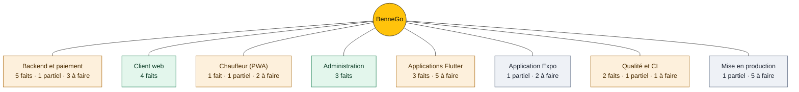

# Feuille de route BenneGo

  

> État au 28 octobre 2026, branche `main` au commit `c4a06a12`. Chaque statut est vérifié dans le code. Rien n'a encore été testé sur un vrai téléphone.

## Schéma

Légende : vert = tout est fait, orange = en cours, gris = pas encore commencé.

## Domaines

### Backend et paiement
API Express · Socket.IO · PostgreSQL

- [x] Paiement en séquestre KKiaPay : vérification serveur, puis répartition 10 % / 90 % à la confirmation
- [x] Litiges, pannes et relèves, reversements chauffeurs avec relances des échecs
- [x] Vérification SMS à l'inscription, bloquée en production sans passerelle
- [x] Baromètre, codes promo, parrainage, avis, reçus PDF, commandes récurrentes
- [x] Tests Jest sur PostgreSQL réel (10 fichiers)
- [ ] **Partiel** : commandes WhatsApp, messages écrits lus, pas de messages vocaux
- [ ] Passerelle SMS (variable `SMS_WEBHOOK_URL`)
- [ ] Virement MoMo automatique : prestataire à brancher (virement manuel aujourd'hui)
- [ ] Clés KKiaPay de production, sandbox à désactiver, webhook à déclarer

### Client web
React · 9 pages

- [x] Vitrine publique, commande (dont camionnette), chantier choisi sur la carte
- [x] Suivi animé du camion, paiement, réception, avis, parrainage
- [x] Espace entreprise : commandes groupées avec facture proforma
- [x] Contrôles d'accessibilité (axe) dans la suite e2e

### Chauffeur (PWA)
React · 4 pages

- [x] Disponibilité, mission, chargement avec photos et volume, pannes, historique, parrainage
- [ ] **Partiel** : suivi GPS seulement quand la page est ouverte, pas écran verrouillé
- [ ] Vérifier l'accueil en ligne à 390 px (une coupure est possible, non reproduite)
- [ ] Confirmer en production la ressource chargée depuis unpkg.com

### Administration
React · 14 pages

- [x] Tableau de bord, commandes, chauffeurs, clients, paiements, avis
- [x] Litiges, pannes et relèves, baromètre, codes promo, parrainage
- [x] Rapport mensuel et espace B2B : proformas et validation du séquestre

### Applications Flutter
Dart · conducteur, client, admin · Android et iOS

- [x] Trois applications et le paquet partagé `bennego_core` (54 fichiers Dart)
- [x] Suivi GPS écran verrouillé : service de premier plan Android, mode localisation iOS (non testé sur appareil)
- [x] Analyse, tests et APK de debug en CI, au vert
- [ ] Tester sur un vrai téléphone, Android et iOS
- [ ] Permission de notifications Android 13 et plus, pour afficher le service de suivi
- [ ] Clé de publication Android (`key.properties`, hors dépôt)
- [ ] Build iOS, jamais lancé (job manuel) et signature Apple
- [ ] Porter le chat de commande, l'espace B2B, les rapports mensuels et les abonnements

### Application Expo (`mobile-driver/`)

- [ ] **Partiel** : parcours aligné sur la PWA : chargement, panne, litige
- [ ] Test sur appareil avant toute distribution
- [ ] Suppression une fois l'application Flutter conducteur validée (décision)

### Qualité et CI
GitHub Actions

- [x] CI Node : build sur Node 20 et 22, migration, build des trois fronts, tests npm
- [x] CI Flutter : analyse, tests des quatre paquets, APK de debug des trois applications
- [ ] **Partiel** : suite e2e Playwright (5 fichiers), lancée en local avec `npm run e2e`
- [ ] Ajouter la suite e2e à la CI

### Mise en production

- [ ] **Partiel** : facturation DGI, proformas B2B et reçus PDF, pas encore de facture normalisée (TVA, AIB)
- [ ] Domaine, hébergement et variables de production (`JWT_SECRET`, CORS, `APP_PUBLIC_URL`)
- [ ] Webhook WhatsApp déclaré chez Meta, avec les quatre variables `WHATSAPP_*`
- [ ] Remplacer les contacts provisoires (`wa.me/22990000000`, `tel:+22900000000`)
- [ ] Comptes Google Play et Apple Developer, politique de confidentialité, fiches store
- [ ] Nettoyer les déploiements GitHub en échec (environnements `logi-truck-*`)

## Roadmap produit

Phases du Masterplan (`lancement.md`). Le dépôt ne les date pas.

| Phase | Élément | Statut | Détail |
|---|---|---|---|
| Phase 1 · mois 1–2 | WhatsApp audio (Fon, français) | Partiel | Commandes écrites lues, messages vocaux pas encore |
| Phase 1 · mois 1–2 | Avance gasoil « BenneGo Fuel » | Retiré | Requête cassée, aucun partenaire station |
| Phase 2 · mois 3–4 | Télémétrie flotte | Partiel | Détection d'arrêts écrite, non branchée, sans interface |
| Phase 2 · mois 3–4 | Algorithme « Zéro camion vide » | À faire | Non commencé |
| Phase 3 · mois 5–6 | Scan volumétrique par caméra | À faire | Non commencé |
| Phase 3 · mois 5–6 | Dépannage poids lourds | Partiel | Pannes et relèves gérées, réseau mécanique pas encore |
| Phase 4 · mois 7–12 | Baromètre officiel des prix BTP | Fait | Indice publié, affiché à l'accueil client |
| Transverse | Séquestre à risque zéro | Fait | Remboursement si la livraison est refusée |
| Transverse | Preuve de pesée | Partiel | Ticket facultatif, avec photo et poids net |
| Transverse | Retrait instantané | Retiré | Jamais branché, le reversement reste celui de la confirmation |

## À trancher

- La phrase « Interface optimisée React & Lucide Icons via npm » est introuvable dans le dépôt et son historique. Où la voyez-vous ?
- Garder ou retirer le camion du logo et de la vitrine ?
- Retirer le 🚛 du fichier « Contrairement à Gozem.txt » ?
- Lancer le build iOS à la demande ? Il consomme des minutes macOS.
- Supprimer `mobile-driver/` une fois l'application Flutter conducteur validée ?
- Retirer le nom du modèle des lignes `Co-Authored-By` des prochains commits ?
- Un déploiement est-il relié à la branche `main` ? Je ne l'ai pas vérifié.

---

Sources : dépôt BenneGo, branche `main` au commit `c4a06a12` (37 commits). Documents : `lancement.md`, `README.md`, `suivi-implementation.md`, `flutter/README.md`. Les statuts reflètent le code, pas un essai sur appareil.
